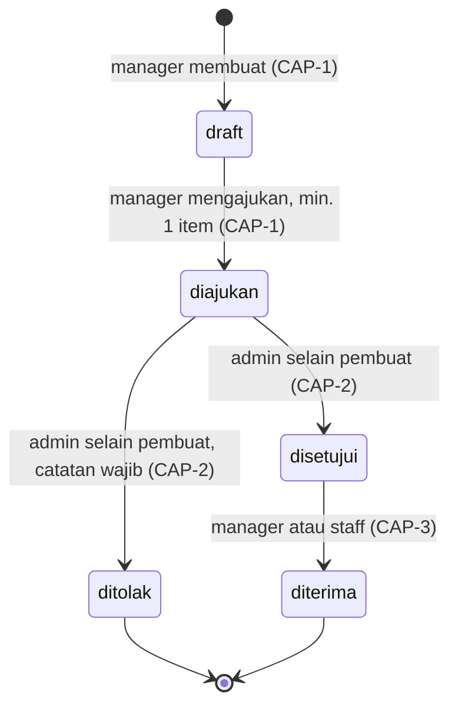

# State machine status PO

Label UI (Bahasa Indonesia) di kiri, siapa yang boleh memicu transisi di panah.

| Status | Item/harga bisa diubah | Bisa dihapus | Transisi keluar |
|---|---|---|---|
| draft | ya (manager) | ya (manager) | diajukan |
| diajukan | tidak | tidak | disetujui, ditolak |
| disetujui | tidak | tidak | diterima |
| ditolak | tidak | tidak | — (final) |
| diterima | tidak | tidak | — (final) |

Setiap transisi mencatat activity (causer = pelaku). Transisi yang tidak ada di tabel ditolak di level domain, bukan hanya disembunyikan di UI.
